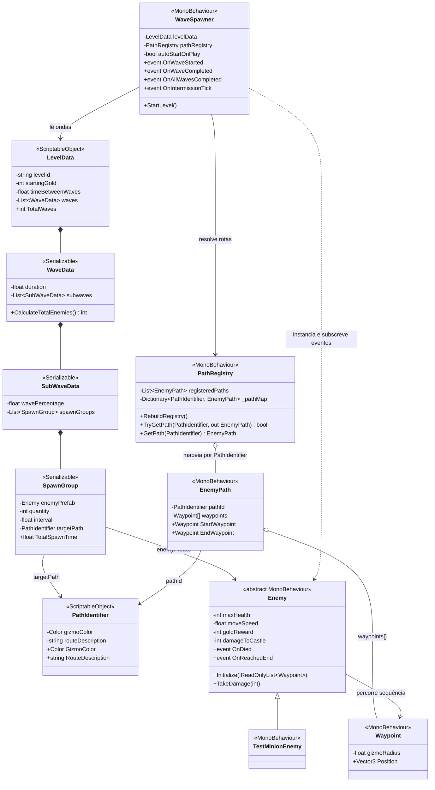
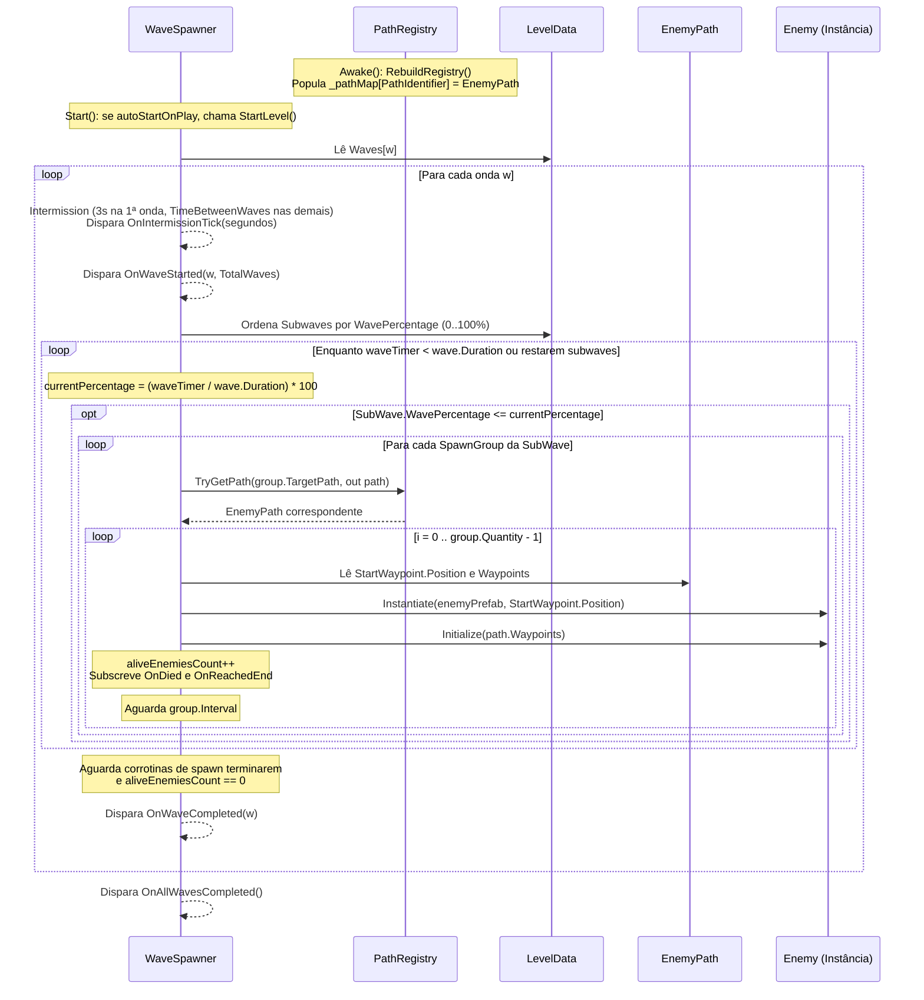

# 🛠️ Documentação Técnica de Desenvolvimento: Framework de Fases, Ondas e Caminhos

**Projeto:** Siege of Hollow Keep (CCC300 · 2026/2)  
**Público-alvo:** Desenvolvedores / Programadores (Jean e Ricardo)  
**Guia de uso relacionado:** [`GUIA_CRIACAO_DE_FASES.md`](./GUIA_CRIACAO_DE_FASES.md)

---

## 1. Visão Arquitetural e Princípios de Design

O framework foi projetado para resolver um problema clássico na Unity: **separar o balanceamento das ondas (que vive em assets no disco) da geometria dos caminhos (que vive na hierarquia de cada cena)**, mantendo **tipagem estrita** e zero dependências de pacotes externos.

### Pilares Técnicos
1. **Separação Dados vs. Cena:** `ScriptableObject`s (`LevelData`) não podem referenciar objetos de cena (`Waypoint` ou `EnemyPath`) diretamente. A ponte entre ambos é feita pelo padrão *Smart Tag / Asset Key* através de `PathIdentifier`.
2. **Tipagem Estrita:** Nenhum campo serializado usa tipos genéricos como `Transform`, `GameObject` ou `string` para referências cruzadas:
   - Rotas aceitam apenas `Waypoint[]` (em vez de `Transform[]`).
   - Lotes de spawn aceitam apenas prefabs derivados de `Enemy` (em vez de `GameObject`).
   - Chaves de rota aceitam apenas `PathIdentifier` (em vez de `string` ou `int`).
3. **Desacoplamento por Eventos:** `Enemy` e `WaveSpawner` expõem eventos C# (`event Action<...>`) para que sistemas futuros (Economia, Vida do Castelo, HUD, Condição de Vitória) se conectem sem acoplamento direto.

---

## 2. Mapa Completo de Arquivos e Namespaces

| Arquivo | Namespace | Tipo | Papel |
|---|---|---|---|
| [`PathIdentifier.cs`](../Assets/Scripts/Level/Identifiers/PathIdentifier.cs) | `HollowKeep.Level` | `ScriptableObject` | Chave tipada de rota e cor de Gizmos no Editor. |
| [`SpawnGroup.cs`](../Assets/Scripts/Level/Data/SpawnGroup.cs) | `HollowKeep.Level.Data` | `[Serializable] class` | Define prefab (`Enemy`), quantidade, intervalo e rota (`PathIdentifier`). |
| [`SubWaveData.cs`](../Assets/Scripts/Level/Data/SubWaveData.cs) | `HollowKeep.Level.Data` | `[Serializable] class` | Define momento de disparo (`wavePercentage`) e lista de `SpawnGroup`. |
| [`WaveData.cs`](../Assets/Scripts/Level/Data/WaveData.cs) | `HollowKeep.Level.Data` | `[Serializable] class` | Define `duration` da janela de spawn e lista de `SubWaveData`. |
| [`LevelData.cs`](../Assets/Scripts/Level/Data/LevelData.cs) | `HollowKeep.Level.Data` | `ScriptableObject` | Configuração completa de uma fase (`levelId`, `startingGold`, `timeBetweenWaves`, `waves`). |
| [`Waypoint.cs`](../Assets/Scripts/Level/Navigation/Waypoint.cs) | `HollowKeep.Level` | `MonoBehaviour` | Nó físico 3D da rota na cena, com Gizmos próprios. |
| [`EnemyPath.cs`](../Assets/Scripts/Level/Navigation/EnemyPath.cs) | `HollowKeep.Level` | `MonoBehaviour` | Associa um `PathIdentifier` a um array ordenado de `Waypoint`s e desenha a trilha na Scene View. |
| [`PathRegistry.cs`](../Assets/Scripts/Level/Navigation/PathRegistry.cs) | `HollowKeep.Level` | `MonoBehaviour` | Catálogo de cena (`Dictionary<PathIdentifier, EnemyPath>`) consultado pelo spawner. |
| [`WaveSpawner.cs`](../Assets/Scripts/Level/Spawning/WaveSpawner.cs) | `HollowKeep.Level.Spawning` | `MonoBehaviour` | Motor de execução das ondas, subondas e ciclo de vida dos inimigos spawnados. |
| [`Enemy.cs`](../Assets/Scripts/Enemies/Enemy.cs) | `HollowKeep.Enemies` | `abstract MonoBehaviour` | Classe base de todos os inimigos: atributos, movimento por waypoints, dano, morte e eventos. |
| [`TestMinionEnemy.cs`](../Assets/Scripts/Enemies/TestMinionEnemy.cs) | `HollowKeep.Enemies` | `MonoBehaviour : Enemy` | Implementação concreta mínima para testes em greybox. |
| [`LevelFrameworkSetupHelper.cs`](../Assets/Scripts/Level/Editor/LevelFrameworkSetupHelper.cs) | `HollowKeep.Editor` | `static class` (`#if UNITY_EDITOR`) | Menus utilitários `HollowKeep/...` para gerar assets de exemplo e montar cena de teste. |

---

## 3. Diagrama de Classes e Dependências



---

## 4. Fluxo de Execução em Runtime (Ciclo de Vida)



---

## 5. Detalhamento Técnico por Módulo

### 5.1. Identificadores e Dados (`HollowKeep.Level` e `HollowKeep.Level.Data`)
* **`PathIdentifier` (`ScriptableObject`):** Não possui lógica de runtime; serve como referência de objeto única usada como chave no `Dictionary<PathIdentifier, EnemyPath>` do `PathRegistry`. Também armazena `GizmoColor` e `RouteDescription` para auxiliar o level designer.
* **`SpawnGroup`:** Contém `enemyPrefab` (`Enemy`), `quantity` (`[Min(1)]`), `interval` (`[Min(0.05f)]`) e `targetPath` (`PathIdentifier`). Expõe a propriedade auxiliar `TotalSpawnTime => (quantity > 0) ? (quantity - 1) * interval : 0f`.
* **`SubWaveData`:** Contém `wavePercentage` (`[Range(0f, 100f)]`) e `spawnGroups` (`List<SpawnGroup>`).
* **`WaveData`:** Contém `duration` (`[Min(1f)]`) e `subwaves`. O método `CalculateTotalEnemies()` soma as quantidades de todos os grupos da onda (útil para UI ou balanceamento).
* **`LevelData` (`ScriptableObject`):** Agrupa `levelId`, `startingGold`, `timeBetweenWaves` e `waves`.

### 5.2. Navegação na Cena (`HollowKeep.Level`)
* **`Waypoint`:** Possui `[SelectionBase]` e `[DisallowMultipleComponent]`. Expõe `Position => transform.position`. Desenha uma esfera aramada azul em `OnDrawGizmos()` e sólida ciano em `OnDrawGizmosSelected()`.
* **`EnemyPath`:** Agrupa `pathId` e `waypoints` (`Waypoint[]`). Expõe `Waypoints` (`IReadOnlyList<Waypoint>`), `WaypointCount`, `StartWaypoint` e `EndWaypoint`.
  * Em `DrawPathGizmos(bool isSelected)`: usa `pathId.GizmoColor` (ou `Color.yellow` como fallback). Quando não selecionado, aplica `alpha = 0.35f`; quando selecionado, desenha em opacidade total com esferas nos nós e um `DrawWireCube` a `60%` de cada segmento para indicar direção.
* **`PathRegistry`:** Em `Awake()` chama `RebuildRegistry()`, que segue uma estratégia de resolução em 3 níveis caso `registeredPaths` esteja vazio no Inspector:
  1. Busca nos filhos com `GetComponentsInChildren(true, registeredPaths)`.
  2. Se ainda estiver vazio, busca na cena inteira com `FindObjectsByType<EnemyPath>(FindObjectsInactive.Include, FindObjectsSortMode.None)`.
  3. Valida `PathId != null` e detecta duplicatas antes de popular `_pathMap`.

### 5.3. Inimigos (`HollowKeep.Enemies`)
* **`Enemy` (classe abstrata):**
  * **Atributos serializados:** `maxHealth` (100), `moveSpeed` (3.5), `goldReward` (15), `damageToCastle` (1), `waypointTolerance` (0.15).
  * **Estado e propriedades:** `CurrentHealth`, `IsDead` (`CurrentHealth <= 0`), além dos getters dos atributos.
  * **Ciclo de vida:**
    * `Awake()`: inicializa `CurrentHealth = maxHealth`.
    * `Initialize(IReadOnlyList<Waypoint> waypoints)`: guarda a lista, zera `_currentWaypointIndex`, teleporta o inimigo para `_waypoints[0].Position` e ativa `_isInitialized`.
    * `Update()` -> `MoveAlongPath()`: calcula direção no plano XZ (`toTarget.y = 0f`). Se `toTarget.magnitude <= waypointTolerance`, avança o índice; ao ultrapassar o último waypoint, chama `ReachEnd()`. Caso contrário, move com `Vector3.MoveTowards` e rotaciona suavemente com `Quaternion.Slerp`.
    * `TakeDamage(int damage)`: reduz `CurrentHealth` (limitado a `0`) e chama `Die()` ao zerar.
    * `Die()` e `ReachEnd()`: invocam respectivamente `OnDied?.Invoke(this)` e `OnReachedEnd?.Invoke(this)`, e depois executam `Destroy(gameObject)`.
* **Como criar um novo tipo de inimigo (ex: Esqueleto, Vampiro, Orc):**
  ```csharp
  namespace HollowKeep.Enemies
  {
      public class SkeletonEnemy : Enemy
      {
          // Sobrescreva Awake(), MoveAlongPath(), TakeDamage() ou Die()
          // apenas se este inimigo tiver comportamento especial (ex.: animação, som, partículas).
          // Caso contrário, basta herdar de Enemy e configurar os atributos no Prefab!
      }
  }
  ```

### 5.4. Spawner (`HollowKeep.Level.Spawning`)
* **`WaveSpawner`:**
  * Se `pathRegistry` não for atribuído no Inspector, localiza automaticamente via `FindFirstObjectByType<PathRegistry>()` no `Awake()` / `StartLevel()`.
  * **Regra de contagem regressiva (`RunLevelRoutine`):** A primeira onda (`w == 0`) usa uma contagem fixa de `3f` segundos; as ondas seguintes usam `levelData.TimeBetweenWaves`. A cada segundo dispara `OnIntermissionTick(intermission)` e ao zerar dispara `OnIntermissionTick(0f)`.
  * **Regra de disparo (`ExecuteWaveRoutine`):** Copia e ordena `wave.Subwaves` por `WavePercentage`. Conforme `waveTimer` avança, qualquer subonda cujo percentual seja `<= (waveTimer / wave.Duration) * 100f` dispara em paralelo uma corrotina `SpawnGroupRoutine` para cada um de seus `SpawnGroup`s.
  * **Condição de conclusão da onda:** O `WaveSpawner` aguarda o término do `wave.Duration`, o término de todas as `_activeSpawnCoroutines` e, por fim, espera `aliveEnemiesCount == 0` (verificado a cada `0.25s`) antes de disparar `OnWaveCompleted(w)`.
  * **Rastreamento de inimigos:** `SpawnGroupRoutine` incrementa `aliveEnemiesCount` ao instanciar e assina `enemy.OnDied` e `enemy.OnReachedEnd` com `HandleEnemyRemoved`, que desassina ambos os eventos e decrementa `aliveEnemiesCount`.

### 5.5. Automação de Editor (`HollowKeep.Editor`)
* **`LevelFrameworkSetupHelper`:** Compilado apenas no Editor (`#if UNITY_EDITOR`). Expõe dois itens no menu superior:
  * `HollowKeep/1. Gerar Assets de Exemplo (Paths, Inimigo, LevelData)`: cria `Assets/Data/Paths/Path_Main.asset`, `Assets/Prefabs/Enemies/TestMinion.prefab`, `Assets/Data/Paths/M_TestMinion.mat` e `Assets/Data/Levels/Level_01.asset` (1 onda de 12s com subondas em 0% e 50%).
  * `HollowKeep/2. Montar Fase de Teste na Cena Atual`: executa o passo 1 e instancia `Ground_Plane`, `Waypoints_Group` (`WP_01`..`WP_04`), `Path_Principal`, `[LEVEL]` (`PathRegistry` + `WaveSpawner`) e posiciona `Camera.main` em visão isométrica.

---

## 6. Pontos de Integração com Futuros Sistemas

Ao implementar o restante do jogo (*Castelo*, *Economia*, *Torres* e *HUD*), utilize os eventos e métodos já existentes sem precisar alterar a lógica interna do spawner:

| Sistema Futuro | Onde Conectar | Como Usar |
|---|---|---|
| **Economia (Ouro)** | `LevelData.StartingGold` e `Enemy.OnDied` | Ler `levelData.StartingGold` no início da partida; somar `enemy.GoldReward` quando `OnDied` disparar. |
| **Vida do Castelo / Derrota** | `Enemy.OnReachedEnd` | Subtrair `enemy.DamageToCastle` da vida do castelo quando `OnReachedEnd` disparar. |
| **Vitória da Fase** | `WaveSpawner.OnAllWavesCompleted` | Exibir tela de vitória caso a vida do castelo esteja `> 0` ao receber `OnAllWavesCompleted`. |
| **HUD (Onda / Timer)** | `WaveSpawner.OnWaveStarted`, `OnIntermissionTick`, `CurrentWaveNumber`, `TotalWaves` | Atualizar textos de `"Onda X / Y"` e contagem regressiva entre ondas. |
| **Torres e Projéteis** | `Enemy.TakeDamage(int)` e `Enemy.IsDead` | Torres miram componentes `Enemy` no alcance; projéteis aplicam dano via `enemy.TakeDamage(damage)`. |
