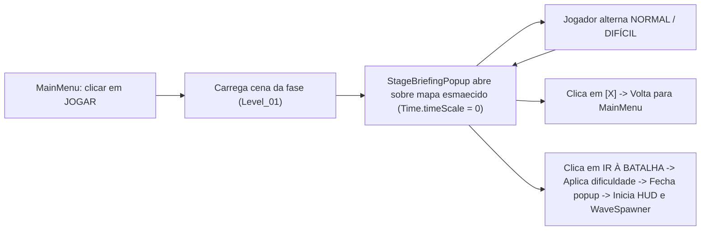

# Plano de Implementação: HUD de Briefing Pré-Fase (`StageBriefingPopup`)

**Projeto:** Siege of Hollow Keep (`tower-defense-ccc300`)  
**Objetivo:** Documentar o passo a passo completo para implementar o popup pré-batalha sobre o mapa esmaecido de cada fase (estilo *PausePopup* + *Kingdom Rush*), evitando perda de contexto entre etapas.

---

## 1. Visão Geral e Fluxo

Ao carregar uma cena de fase (ex.: `Assets/Scenes/Level_01.unity`), o jogo inicia **pausado sobre o mapa 3D esmaecido** (`Color(0.1f, 0.07f, 0.04f, 0.78f)`, mesmo estilo do `PausePopup`), exibindo o **`StageBriefingPopup`** antes de a preparação/ondas começarem.



### Comportamento de Entrada e Bloqueio
- Enquanto o `StageBriefingPopup` estiver aberto:
  - `Time.timeScale = 0f` (ou `WaveSpawner` aguardando início manual, `autoStartOnPlay = false`).
  - `GameHUDController.IsInputBlocked` retorna `true` para impedir cliques acidentais em `BuildSlot`s (`BuildMenuUI`) e desabilitar `pauseButton` / `speedButton` / `advanceWaveButton`.
- Ao clicar em **`IR À BATALHA`**:
  1. Salva o perfil selecionado em `GameSessionConfig.SetDifficulty(selectedProfile)`.
  2. Fecha o `StageBriefingPopup` e restaura `Time.timeScale = 1f`.
  3. Atualiza ouro inicial e vidas em `GameHUDController` conforme a dificuldade escolhida e reativa os botões da HUD.
  4. Chama `waveSpawner.StartLevel()`.
- Ao clicar em **`[X]`**:
  - Restaura `Time.timeScale = 1f` e volta para `MainMenu`.

---

## 2. Layout Aprovado (Wireframe)

- **Título (`FASE 1`)** alinhado no topo da **coluna direita**, logo acima do texto descritivo (não centralizado sobre o popup inteiro).
- **Miniatura do mapa cartográfico** na **coluna esquerda**, montada com sprites do `kenney_cartography-pack`.
- **Seletor de dificuldade** posicionado **à direita**, imediatamente ao lado do botão **`IR À BATALHA`**.

```text
+-----------------------------------------------------------------------------+
| [Overlay Escuro Esmaecido sobre o Mapa 3D da Fase - estilo PausePopup]      |
|                                                                             |
|  +-----------------------------------------------------------------------+  |
|  |                                                                   [X] |  |
|  |  +---------------------------+   FASE 1                               |  |
|  |  | (árv.)    +------+   ^    |   ------------------------------------ |  |
|  |  |  [flag]   |      |  / \   |   Saudações, Comandante!               |  |
|  |  |    |      +--+   |        |                                        |  |
|  |  |    +------+  |   | (cem.) |   Esqueletos e criaturas do cemitério  |  |
|  |  |              |   |        |   marcham pela estrada antiga rumo a   |  |
|  |  |       +------+   |        |   Hollow Keep. Posicione arqueiros e   |  |
|  |  |       |                   |   canhões antes que a noite caia!      |  |
|  |  |      [CASTELO]            |                                        |  |
|  |  +---------------------------+                                        |  |
|  |                                  DIFICULDADE                          |  |
|  |                                  [ NORMAL ] [ DIFÍCIL ] [IR À BATALHA]|  |
|  |                                  20 vidas · ritmo padrão              |  |
|  +-----------------------------------------------------------------------+  |
+-----------------------------------------------------------------------------+
```

---

## 3. Assets e Peças Reaproveitadas

Todos os sprites e fontes já existem no projeto:

- **Moldura e papel do card/botões:**
  - `Assets/UI/Sprites/CartographyCardFill.png` (`guid: 6dc3f5d7c7e18553eadae815bf89a460`)
  - `Assets/UI/Sprites/CartographyFrameOuter.png` (`guid: 7f3c91a4e2b84d609a1c5e7d2b4f8e10`)
  - Fonte: `Assets/UI/Fonts/Kenney High SDF.asset` (`guid: 25a2d3c3cec402d6c89811b8fbbe0997`)
- **Miniatura cartográfica do mapa (`Assets/KenneyPack/UI/kenney_cartography-pack/PNG/Retina/`):**
  - Caminho: `pathStraight.png`, `pathCorner.png`
  - Pontos/props: `castle.png`, `flag.png`, `treePines.png`, `graveyard.png`
  - Ícones de ação: `elementShield.png` (botão *Ir à Batalha*), `elementCross.png` (botão *Fechar `[X]`*)
- **Perfis de dificuldade existentes:**
  - `Assets/Data/Difficulty/Difficulty_Normal.asset`
  - `Assets/Data/Difficulty/Difficulty_Hard.asset`

---

## 4. Passo a Passo de Implementação

### Passo 1 — Ajustar `GameHUDController.cs` e `WaveSpawner.cs` para início sob demanda
1. Em `Assets/Scripts/UI/GameHUDController.cs`:
   - Adicionar suporte a estado de briefing aberto (`SetBriefingActive(bool active)` / `IsInputBlocked => _isPaused || _isGameOver || _isVictory || _isBriefingOpen`).
   - Extrair a inicialização de recursos (`ApplySessionDifficulty()`) de `Start()` para poder ser chamada após o jogador escolher a dificuldade e clicar em **`IR À BATALHA`**.
   - Enquanto `_isBriefingOpen` for `true`: desativar interação de `pauseButton`, `speedButton` e `advanceWaveButton`, e manter `Time.timeScale = 0f`.
2. Em `Assets/Scripts/Level/Spawning/WaveSpawner.cs`:
   - Na cena (`Level_01.unity`), configurar `autoStartOnPlay = false` (ou deixar o `StageBriefingController` controlar quando chamar `StartLevel()`).
   - Garantir fallback seguro: se não houver `StageBriefingController` ativo na cena, o `WaveSpawner` inicia normalmente no `Start()` caso `autoStartOnPlay == true`.

### Passo 2 — Criar `StageBriefingController.cs` (Reutilizável via `LevelCore.prefab`)
Criar `Assets/Scripts/UI/StageBriefingController.cs` (`namespace HollowKeep.UI`) com:
1. **Campos por fase em `LevelData` (`StageTitle`, `StageDescription`, `MapPreviewVariant`) + fallbacks no controlador:**
   - `defaultTitle` (`"FASE 1"`) e `defaultDescription` caso algum `LevelData` não preencha os campos
   - `normalDifficulty` (`DifficultyProfile` → `Difficulty_Normal.asset`) e `hardDifficulty` (`DifficultyProfile` → `Difficulty_Hard.asset`)
   - `mainMenuSceneName` (`"MainMenu"`)
2. **Referências de UI e Cena:**
   - `popupRoot` (`GameObject`), `titleText`, `descriptionText`, `difficultySummaryText` (`TMP_Text`), `mapPreviewLevel01`, `mapPreviewLevel02`
   - `normalButton`, `hardButton`, `battleButton`, `closeButton` (`Button`)
   - `normalButtonGraphic`, `hardButtonGraphic` (`Image`, destacando a dificuldade ativa)
   - `waveSpawner` (`WaveSpawner`), `hudController` (`GameHUDController`)
3. **Comportamento:**
   - No `Start()`: abre o popup, seleciona `GameSessionConfig.SelectedDifficulty ?? normalDifficulty` como padrão visual, atualiza `titleText`/`descriptionText`/`difficultySummaryText`, bloqueia HUD via `hudController.SetBriefingActive(true)` e pausa `Time.timeScale = 0f`.
   - Ao clicar em `normalButton` ou `hardButton`: atualiza `_selectedDifficulty`, destaca o botão ativo e atualiza o texto curto de resumo (ex.: `"20 vidas · ritmo padrão"` vs `"10 vidas · inimigos +35% HP"`).
   - Ao clicar em `battleButton`:
     1. Chama `GameSessionConfig.SetDifficulty(_selectedDifficulty)`.
     2. Chama `hudController.ApplySessionDifficulty()` e `hudController.SetBriefingActive(false)`.
     3. Fecha `popupRoot`, restaura `Time.timeScale = 1f` e inicia `waveSpawner.StartLevel()`.
   - Ao clicar em `closeButton`: restaura `Time.timeScale = 1f` e carrega `mainMenuSceneName`.

### Passo 3 — Montar `StageBriefingPopup` dentro de `LevelCore.prefab` (reutilizado em `Level_01.unity` e `Level_02.unity`)
1. Montar `StageBriefingPopup` diretamente dentro de `GameHUDCanvas` em `Assets/Prefabs/LevelCore.prefab` (instância compartilhada pelas fases `Level_01` e `Level_02`), usando os campos de `LevelData` (`StageTitle`, `StageDescription`, `MapPreviewVariant`) em `Level_01.asset` e `Level_02.asset`:
   - Raiz `StageBriefingPopup` (stretch total, `Image` escura `r: 0.1, g: 0.07, b: 0.04, a: 0.78` igual ao `PausePopup`, ativa ao carregar a fase).
   - `BriefingCard` central (`920 x 470`, `CartographyCardFill` + `Frame` com `CartographyFrameOuter`).
   - `CloseButton` no canto superior direito do card (ícone `elementCross`).
   - **Esquerda (`MapPreviewFrame`):** moldura cartográfica (`332 x 396`) com fundo pergaminho mais escuro e variações `MapPreview_Level01` / `MapPreview_Level02` em `Image` dos sprites `pathStraight`, `pathCorner`, `pathSplit`, `castle`, `castleWide`, `flag`, `treePines` e `graveyard`.
   - **Direita (`RightColumn`):**
     - Topo: `StageTitleText` (`"FASE 1"` / `"FASE 2"`, `Kenney High SDF`, `48pt`) acima de `StageDescriptionText`.
     - Rodapé (`BottomControlsRow`): seletor de dificuldade (`NormalButton` + `HardButton` + `DifficultySummaryText`) à direita, lado a lado com `BattleButton` (`"IR À BATALHA"` + ícone `elementShield`).
2. Status da implementação:
   - [x] `LevelData` + `Level_01.asset` + `Level_02.asset` atualizados (`stageTitle`, `stageDescription`, `mapPreviewVariant`).
   - [x] `WaveSpawner.SuppressAutoStart()` e `GameHUDController.SetBriefingActive(...)` / `ApplySessionDifficulty()` implementados.
   - [x] `StageBriefingController.cs` implementado e configurado no `StageBriefingPopup` dentro de `Assets/Prefabs/LevelCore.prefab`.

### Passo 4 — Validação no Editor Unity (Play Mode)
1. Abrir `Level_01` ou `Level_02` a partir de `MainMenu` → conferir `StageBriefingPopup` aberto sobre mapa esmaecido (nenhum inimigo nasce ainda; clique fora não abre menu de torres).
2. Clicar em `[X]` → volta para `MainMenu`.
3. Entrar novamente, alternar `NORMAL` / `DIFÍCIL`, clicar em `IR À BATALHA` → popup fecha, ouro (`150` vs `120`) e vidas (`20` vs `10`) atualizam na hora, preparação da Onda 1 inicia normalmente.
