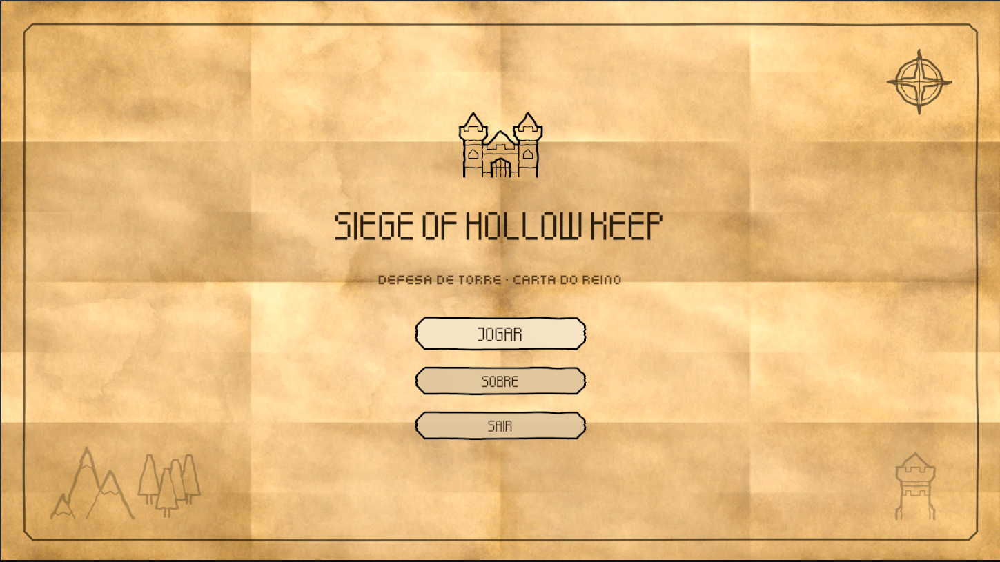
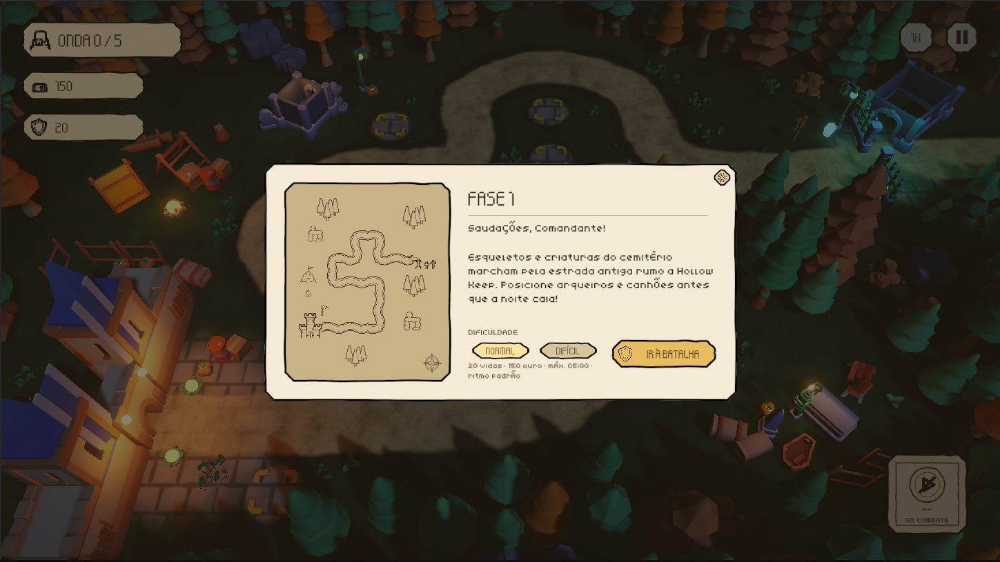
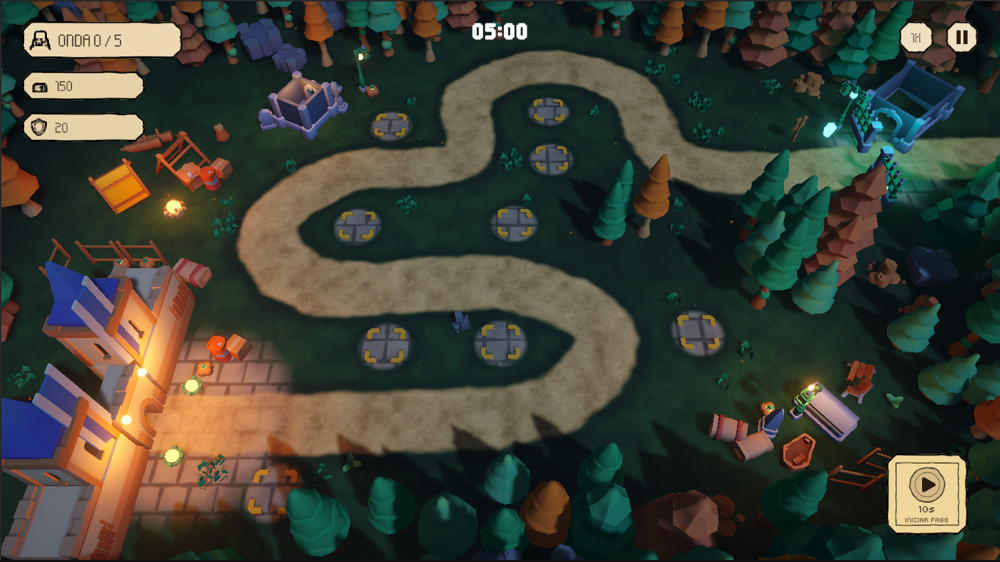
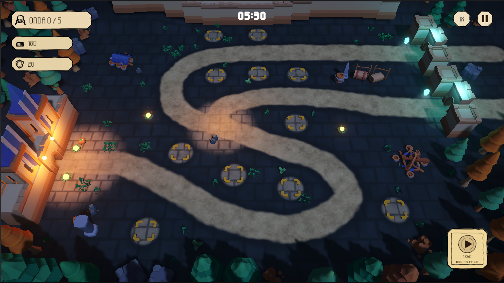
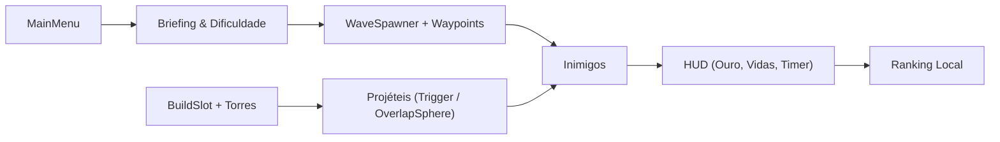

# Siege of Hollow Keep

Tower Defense 3D de câmera fixa onde você defende os portões de uma fortaleza contra ondas de mortos-vivos e cultistas, decidindo onde construir, quando evoluir suas torres e quando acelerar a próxima horda por ouro extra.


-141619?style=flat-square)

Trabalho prático da disciplina **CCC300 · Computação Gráfica e Realidade Virtual (UPF 2026/2)**  
Dupla: **Jean L. Alba** e **Ricardo Zancan**

[Entrega](#entrega) · [O jogo](#o-jogo) · [Telas](#telas) · [Torres e inimigos](#torres-e-inimigos) · [Como jogar](#como-jogar) · [Como executar](#como-executar) · [Arquitetura](#arquitetura-e-organização)

---

## Entrega

| Item | Link |
|---|---|
| **Executável do jogo** | [Baixar demo (GitHub Releases)](https://github.com/JeanAlba/tower-defense-ccc300/releases/tag/demo) |
| **Vídeo demonstrativo** | [Assistir no Google Drive](https://drive.google.com/file/d/1UnudTEaIySDDkIqBCNP-yl7CH9xb9qls/view?usp=drive_link) |
| **Repositório GitHub** | [JeanAlba/tower-defense-ccc300](https://github.com/JeanAlba/tower-defense-ccc300) |


---

## O jogo

A fortaleza de Hollow Keep está sob cerco noturno. Os inimigos marcham por rotas fixas até o portão do castelo, e cada abate rende ouro para levantar novas defesas ou melhorar as que já estão no campo.

- **Duas fases com traçados distintos:** a Fase 1 traz uma estrada única sinuosa; a Fase 2 divide a invasão em dois caminhos em Y que convergem para um gargalo antes da base.
- **Dois níveis de dificuldade:** **Normal** e **Difícil**, escolhidos na tela de briefing antes da batalha, alterando vidas, economia, força das hordas e tempo limite.
- **Construção e gerenciamento em anel radial:** clique em um slot vazio para ver o alcance e construir, ou clique em uma torre pronta para evoluir ao Nível 2 ou demolir recuperando 70% do ouro investido.
- **Controle de ritmo:** botão de velocidade **1x / 2x**, pausa e opção de adiantar a próxima onda (liberada perto do fim da onda atual) em troca de ouro bônus.
- **Vitória, derrota e ranking:** você vence ao conter todas as ondas com o castelo de pé e perde se as vidas zerarem ou o cronômetro da partida acabar. Os melhores tempos de cada fase ficam salvos no ranking do menu **Sobre**.
- **Atmosfera e feedback:** cenários *low-poly* com assets **Kenney (CC0)**, iluminação noturna, interface cartográfica, partículas de impacto/explosão e trilha com efeitos sonoros para disparos, construções e eventos da partida.

---

## Telas

| Menu principal | Briefing pré-fase e dificuldade |
|---|---|
|  |  |

| Fase 1 — Construção e combate | Fase 2 — Caminhos bifurcados |
|---|---|
|  |  |

---

## Torres e inimigos

### Torres defensivas

| Torre | Custo | Alcance | Cadência | Dano | Comportamento |
|---|---|---|---|---|---|
| **Torre Arqueira** | 50 ouro | 6,2 | 2,0 tiros/s | 12 | Disparo direto contínuo contra alvo único |
| **Torre Canhão** | 80 ouro | 4,5 | 0,6 tiros/s | 35 (área) | Arco parabólico com predição de rota e dano em área |

Toda torre pode evoluir para o **Nível 2** (80% do custo base para `+45%` de dano, `+20%` de cadência e `+0,75` de alcance) ou ser demolida com **70% de reembolso** sobre o total gasto nela.

### Inimigos

| Inimigo | Vida | Velocidade | Recompensa | Dano à base | Perfil |
|---|---|---|---|---|---|
| **Corredor** | 45 | 4,9 | 7 ouro | 1 | Rápido, pressiona brechas na defesa |
| **Esqueleto** | 75 | 3,1 | 10 ouro | 1 | Infantaria básica em grupo |
| **Cultista** | 160 | 2,7 | 18 ouro | 2 | Resistência intermediária |
| **Brutamontes** | 320 | 1,85 | 30 ouro | 3 | Lento e resistente, exige foco ou dano em área |
| **Campeão** | 900 | 1,55 | 60 ouro | 8 | Chefe da última onda |

### Dificuldades

| Dificuldade | Vidas do castelo | Ouro inicial | Força das hordas | Tempo limite |
|---|---|---|---|---|
| **Normal** | 20 | Padrão (`150` / `180`) | Valores base | `05:00` (Fase 1) · `05:30` (Fase 2) |
| **Difícil** | 10 | 85% do padrão | `+35%` vida, `+15%` velocidade, `+25%` inimigos, intervalos menores | `04:15` (Fase 1) · `04:41` (Fase 2) |

---

## Como jogar

1. No menu inicial, clique em **Jogar** (ou abra **Sobre** para ver controles e ranking).
2. No briefing da fase, escolha entre **Normal** e **Difícil** e clique em **Batalhar**.
3. Clique em um slot livre para abrir o anel radial e construir uma **Torre Arqueira** ou **Torre Canhão**; clique em torres já construídas para **Evoluir** ou **Demolir**.
4. Use o botão no canto inferior direito para iniciar a primeira onda antes do tempo ou adiantar ondas seguintes por ouro extra, e os controles no canto superior direito para alternar **1X / 2X** ou pausar.
5. Sobreviva a todas as ondas antes que a vida da base chegue a zero ou o cronômetro no topo da tela termine.

---

## Como executar

### Pelo executável

Baixe e extraia o arquivo do link em [Entrega](#entrega) e execute o binário do jogo.

### Pelo Unity Editor

Requer **Unity 6000.3.25f1** (URP 17.3.0 e Input System 1.20.0).

```bash
git clone https://github.com/JeanAlba/tower-defense-ccc300.git
cd tower-defense-ccc300
```

1. Abra a pasta do projeto pelo **Unity Hub** com a versão `6000.3.25f1`.
2. Abra `Assets/Scenes/MainMenu.unity` para iniciar pelo fluxo completo (ou abra `Level_01.unity` / `Level_02.unity` direto no editor).
3. Para gerar uma build, confirme `MainMenu`, `Level_01` e `Level_02` ativos em **File → Build Profiles**.

---

## Arquitetura e organização

### Fluxo da partida



### Estrutura de pastas

```text
tower-defense-ccc300/
├── Assets/
│   ├── Data/               ScriptableObjects de fases, ondas, rotas, inimigos e dificuldades
│   ├── Prefabs/            Slots, torres, projéteis, inimigos, menu radial e partículas
│   ├── Resources/Audio/    Trilha sonora e clipes SFX
│   ├── Scenes/             MainMenu, Level_01 e Level_02
│   └── Scripts/
│       ├── Audio/          GameAudioManager
│       ├── Enemies/        Enemy, EnemyStatsData e barra de vida
│       ├── Level/          WaveSpawner, EnemyPath, Waypoint, MatchRankingService e editores
│       ├── Projectiles/    Projectile, DirectProjectile e ParabolicProjectile
│       ├── Towers/         BuildSlot, Tower, DirectTower, ParabolicTower e indicador de alcance
│       ├── UI/             MainMenuController, StageBriefingController, GameHUDController e BuildMenuUI
│       └── VFX/            VfxSpawner
└── Docs/
    └── Screenshots/        Capturas usadas neste README
```
